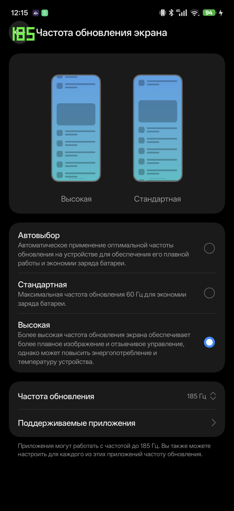
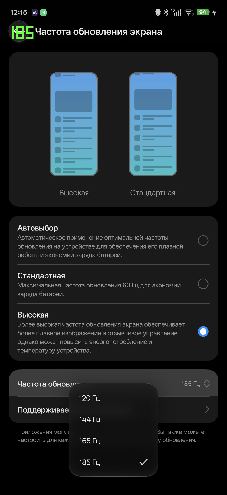

# OP16HzUnlock — 144 Hz & 185 Hz Unlock for OnePlus 16 / 15 (ColorOS 17)

**English** | [Русский](README.ru.md)

Lightweight, open-source, fully systemless **LSPosed / Vector** module (~16 KB) that unlocks the native **144 Hz** and **185 Hz** display modes on **OnePlus 16 (PYB110)** / **OnePlus 15** running **ColorOS 17 (Android 17)** and integrates them directly into the stock ColorOS Display Settings menu.

---

## Features

- **Native Settings UI integration** — adds all 4 high refresh rate options (**120 Hz / 144 Hz / 165 Hz / 185 Hz**) to *Settings → Display & brightness → Screen refresh rate → High → Refresh rate*.
- **True hardware switching** — removes `OplusRefreshRatePolicyImpl` system-wide 120/165 Hz caps so `SurfaceFlinger` switches to real hardware modes (`144.00 Hz`, `165.00 Hz`, `185.00 Hz`) across the system and third-party apps.
- **Fixes 60 Hz fallback bug (v1.1)** — hooks `OplusRefreshRatePolicyImpl$SettingsObserver.updatePeakRefreshRate()` and `resetMinRefreshRate()`, preventing ColorOS from forcibly resetting `min_refresh_rate` to `0.0` (which caused `DisplayModeDirector` to clamp rendering to 60 Hz).
- **Safe & systemless** — preserves Camera refresh limits, AOD 30 Hz, Standard 60 Hz, and adaptive LTPO in Auto mode. Does not modify any system partitions (`boot`, `super`, `vbmeta`) and works even with temporary LKM root on a locked bootloader.

---

## Screenshots

| Active 185 Hz in Settings | Dropdown 120 / 144 / 165 / 185 Hz |
| :---: | :---: |
|  |  |

---

## Requirements

- **Device:** OnePlus 16 (`PYB110`, tested on ColorOS 17 / Android 17). Should also work on OnePlus 15 (same display architecture and `OplusRefreshRatePolicyImpl`).
- **Framework:** LSPosed / Vector / JingMatrix LSPosed (Zygisk).

---

## Installation

1. Download and install **`OP16HzUnlock-1.1.apk`** from [Releases](../../releases).
2. Open **LSPosed / Vector Manager → Modules → OP16 144/185 Гц** and enable the module.
3. Enable **exactly 2 targets** in Scope:
   - **System Framework** (`system`)
   - **Settings** (`com.android.settings`)
4. Reboot your device (if using temporary LKM root on a locked bootloader, use **Soft Reboot**: `su -c "/data/adb/ksud soft-reboot"`).
5. Go to **Settings → Display & brightness → Screen refresh rate → High → Refresh rate** and choose **120 / 144 / 165 / 185 Hz**.

---

## Verification via ADB

```bash
adb shell "su -c 'dumpsys SurfaceFlinger | grep -E \"activeMode=|renderRate=\" | head -n 4'"
```

Expected output on OnePlus 16:

```text
120 Hz: activeMode={id=9,  hwcId=9,  resolution=1080x2354, vsyncRate=120.00 Hz}, renderRate=120.00 Hz
144 Hz: activeMode={id=11, hwcId=11, resolution=1080x2354, vsyncRate=144.00 Hz}, renderRate=144.00 Hz
165 Hz: activeMode={id=12, hwcId=12, resolution=1080x2354, vsyncRate=165.00 Hz}, renderRate=165.00 Hz
185 Hz: activeMode={id=13, hwcId=13, resolution=1080x2354, vsyncRate=185.00 Hz}, renderRate=185.00 Hz
```

---

## How It Works

All hooks live in a single clean file: [`src/com/op16/hzunlock/RefreshRateUnlockHook.java`](src/com/op16/hzunlock/RefreshRateUnlockHook.java).

- **`system` (`oplus-services.jar`)**:
  - `OplusRefreshRateConfigs.getDefaultRateId(int)` — maps rate IDs `4` (144 Hz), `7` (165 Hz), and `8` (185 Hz) directly instead of falling back to `3` (120 Hz).
  - `OplusRefreshRatePolicyImpl$PickRefreshRateData.getPickPreferredId()` & `getWindowPreferredModeId(int, DisplayInfo)` — applies the selected high rate across apps while preserving AOD (30 Hz) and camera restrictions.
  - `forceMaxRefreshRateSettings`, `adjustRefreshForDefaultMax`, `getMaxRateIdInLimit144` — disables downward rate capping when 144/165/185 Hz is active.
  - `OplusRefreshRatePolicyImpl$SettingsObserver.updatePeakRefreshRate()` & `resetMinRefreshRate()` — keeps `peak_refresh_rate` and `min_refresh_rate` synchronized with the chosen rate so `DisplayModeDirector` does not clamp rendering back to 60 Hz.
- **`com.android.settings` (`Settings.apk`)**:
  - `ScreenRefreshUtils.getExtremeRefreshLevelRate()` — returns `185` instead of `165`.
  - `ScreenRefreshUtils.setChoiceModeRate` / `normalizeHighRefreshGear` / `setRateMode` — persists `choice_mode_rate` and `oplus_customize_screen_refresh_rate` (`3/4/7/8`).
  - `ScreenRefreshRateFragment.setupRefreshRateSettingEntries` / `refreshRateSettingSummary` — populates the native ColorOS dropdown with `120 / 144 / 165 / 185 Гц`.

---

## Building from Source

Requires **JDK 11+** and **Android SDK** (`aapt2`, `d8`, `zipalign`, `apksigner`, `android.jar`). Update `SDK` and `KEYSTORE` paths in `build.sh`, then run:

```bash
./build.sh
```

---

## Changelog

- **v1.1** — Fixed 144 Hz / 165 Hz / 120 Hz falling back to 60 Hz by hooking `SettingsObserver.updatePeakRefreshRate()` and `resetMinRefreshRate()`, and cleared sticky `mOverridePeakRefreshRate` when switching down.
- **v1.0** — Initial release with 120 / 144 / 165 / 185 Hz Settings UI dropdown and `system_server` policy hooks.

---

## License

MIT
