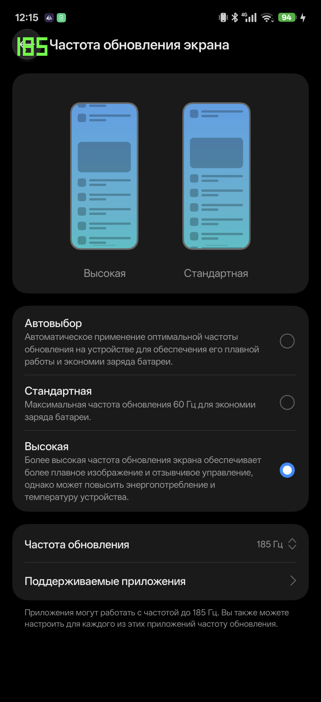
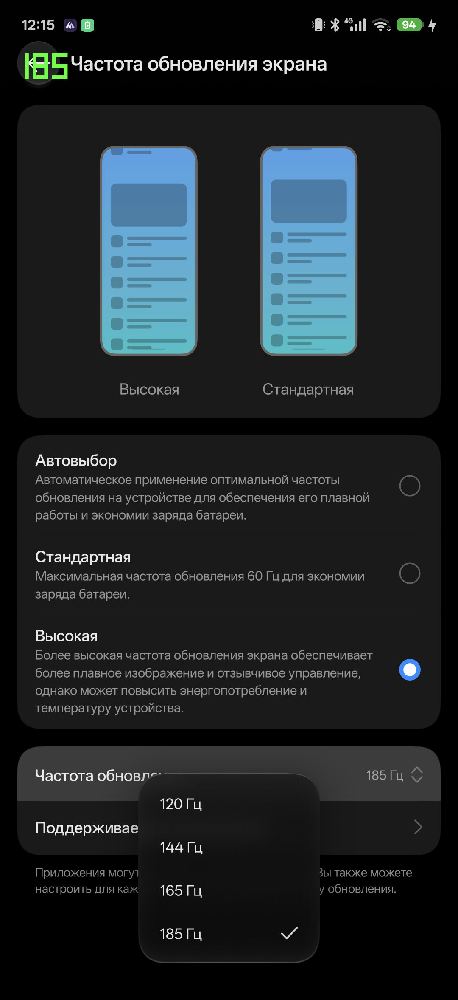

# OP16HzUnlock — разблокировка 144 Гц и 185 Гц на OnePlus 16 / 15 (ColorOS 17)

[English](README.md) | **Русский**

Лёгкий open-source LSPosed / Vector-модуль (~16 КБ, полностью systemless, не требует разблокировки загрузчика), который разблокирует аппаратно поддерживаемые матрицей режимы **144 Гц** и **185 Гц** на **OnePlus 16 (PYB110)** / **OnePlus 15** с **ColorOS 17 (Android 17)** и добавляет их прямо в штатное меню настроек экрана.

---

## Возможности

- **Нативная интеграция в Настройки ColorOS** — добавляет выбор всех 4 частот (**120 Гц / 144 Гц / 165 Гц / 185 Гц**) в *Настройки → Экран и яркость → Частота обновления экрана → Высокая → Частота обновления*.
- **Реальное аппаратное переключение** — снимает системное ограничение `OplusRefreshRatePolicyImpl` (120/165 Гц), позволяя `SurfaceFlinger` реально переключаться на режимы `144.00 Hz`, `165.00 Hz` и `185.00 Hz` в системе и сторонних приложениях.
- **Исправление сброса на 60 Гц (v1.1)** — перехватывает `OplusRefreshRatePolicyImpl$SettingsObserver.updatePeakRefreshRate()` и `resetMinRefreshRate()`, не давая ColorOS сбрасывать `min_refresh_rate` в `0.0` (из-за чего `DisplayModeDirector` зажимал рендер на 60 Гц).
- **Безопасно и полностью systemless** — не затрагивает камеру, AOD 30 Гц, стандартные 60 Гц и адаптивное LTPO в режиме «Автовыбор». Не модифицирует системные разделы (`boot`, `super`, `vbmeta`) и работает даже с временным LKM-рутом на заблокированном загрузчике.

---

## Скриншоты

| Активные 185 Гц в Настройках | Выпадающий список 120 / 144 / 165 / 185 Гц |
| :---: | :---: |
|  |  |

---

## Требования

- **Устройство:** OnePlus 16 (`PYB110`, проверено на ColorOS 17 / Android 17). Также должно работать на OnePlus 15 (аналогичная матрица и архитектура `OplusRefreshRatePolicyImpl`).
- **Фреймворк:** LSPosed / Vector / JingMatrix LSPosed (Zygisk).

---

## Установка

1. Скачайте и установите **`OP16HzUnlock-1.1.apk`** из раздела [Releases](../../releases).
2. Откройте **LSPosed / Vector Manager → Модули → OP16 144/185 Гц** и включите модуль.
3. Отметьте в области действия (Scope) ровно **2 пункта**:
   - **Система Android** (`system`)
   - **Настройки** (`com.android.settings`)
4. Перезагрузите устройство (если используется временный LKM-рут на заблокированном загрузчике — сделайте **Soft Reboot**: `su -c "/data/adb/ksud soft-reboot"`).
5. Перейдите в **Настройки → Экран и яркость → Частота обновления экрана → Высокая → Частота обновления** и выберите **120 / 144 / 165 / 185 Гц**.

---

## Проверка реальной частоты через ADB

```bash
adb shell "su -c 'dumpsys SurfaceFlinger | grep -E \"activeMode=|renderRate=\" | head -n 4'"
```

Ожидаемый вывод на OnePlus 16:

```text
120 Hz: activeMode={id=9,  hwcId=9,  resolution=1080x2354, vsyncRate=120.00 Hz}, renderRate=120.00 Hz
144 Hz: activeMode={id=11, hwcId=11, resolution=1080x2354, vsyncRate=144.00 Hz}, renderRate=144.00 Hz
165 Hz: activeMode={id=12, hwcId=12, resolution=1080x2354, vsyncRate=165.00 Hz}, renderRate=165.00 Hz
185 Hz: activeMode={id=13, hwcId=13, resolution=1080x2354, vsyncRate=185.00 Hz}, renderRate=185.00 Hz
```

---

## Как это работает под капотом

Все хуки находятся в одном файле без обфускации: [`src/com/op16/hzunlock/RefreshRateUnlockHook.java`](src/com/op16/hzunlock/RefreshRateUnlockHook.java).

- **`system` (`oplus-services.jar`)**:
  - `OplusRefreshRateConfigs.getDefaultRateId(int)` — возвращает rateId `4` (144 Гц), `7` (165 Гц) и `8` (185 Гц) напрямую вместо дефолтного `3` (120 Гц).
  - `OplusRefreshRatePolicyImpl$PickRefreshRateData.getPickPreferredId()` и `getWindowPreferredModeId(int, DisplayInfo)` — применяют выбранный пользователем rateId ко всем приложениям, сохраняя AOD (30 Гц) и ограничения камеры.
  - `forceMaxRefreshRateSettings`, `adjustRefreshForDefaultMax`, `getMaxRateIdInLimit144` — отключают принудительное снижение частоты при активных 144/165/185 Гц.
  - `OplusRefreshRatePolicyImpl$SettingsObserver.updatePeakRefreshRate()` и `resetMinRefreshRate()` — удерживают `peak_refresh_rate` и `min_refresh_rate` синхронизированными с выбранной частотой, не давая `DisplayModeDirector` сбрасывать рендер на 60 Гц.
- **`com.android.settings` (`Settings.apk`)**:
  - `ScreenRefreshUtils.getExtremeRefreshLevelRate()` — возвращает `185` вместо `165`.
  - `ScreenRefreshUtils.setChoiceModeRate` / `normalizeHighRefreshGear` / `setRateMode` — сохраняют `choice_mode_rate` и `oplus_customize_screen_refresh_rate` (`3/4/7/8`).
  - `ScreenRefreshRateFragment.setupRefreshRateSettingEntries` / `refreshRateSettingSummary` — заполняют штатный выпадающий список ColorOS значениями `120 / 144 / 165 / 185 Гц`.

---

## Сборка из исходников

Требуются **JDK 11+** и **Android SDK** (`aapt2`, `d8`, `zipalign`, `apksigner`, `android.jar`). Укажите свои пути `SDK` и `KEYSTORE` в `build.sh` и выполните:

```bash
./build.sh
```

---

## История изменений

- **v1.1** — Исправлен откат 120 / 144 / 165 Гц на 60 Гц через хуки `SettingsObserver.updatePeakRefreshRate()` и `resetMinRefreshRate()`, а также сброс залипающего `mOverridePeakRefreshRate` при понижении частоты.
- **v1.0** — Первый релиз: выпадающий список 120 / 144 / 165 / 185 Гц в Настройках и системные хуки `system_server`.

---

## Лицензия

MIT
